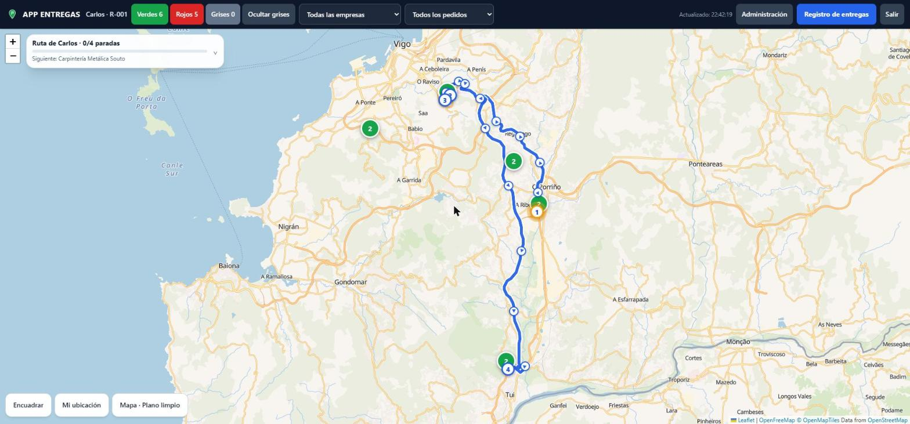
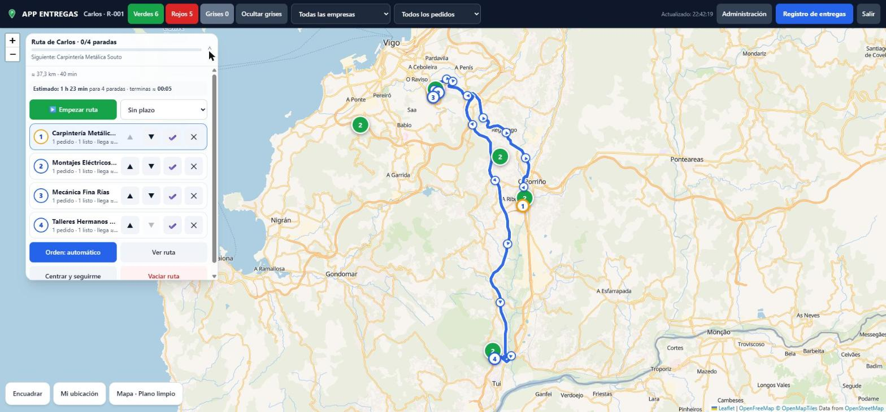
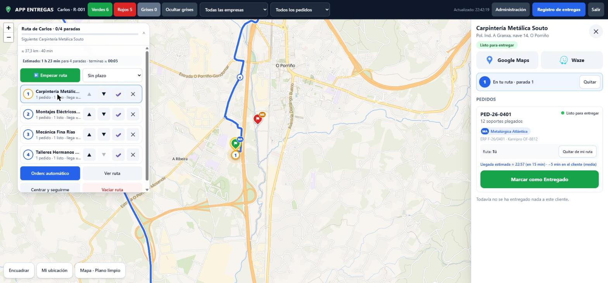
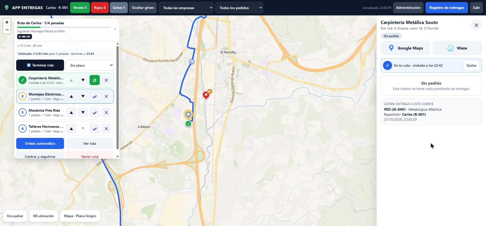
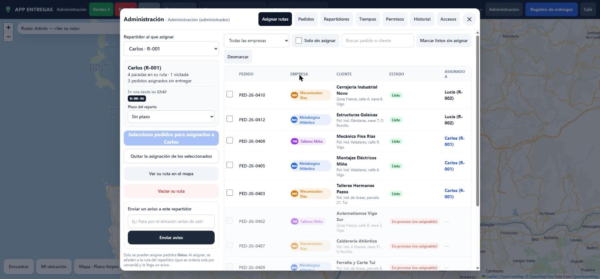
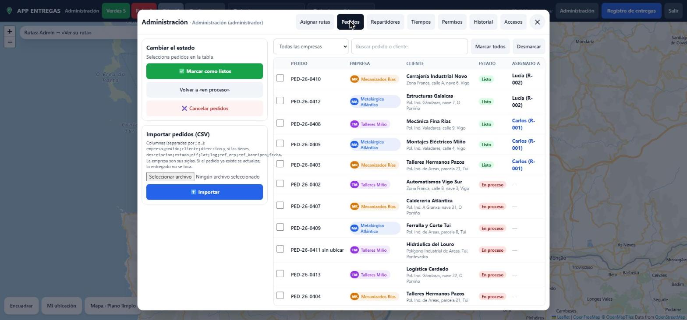
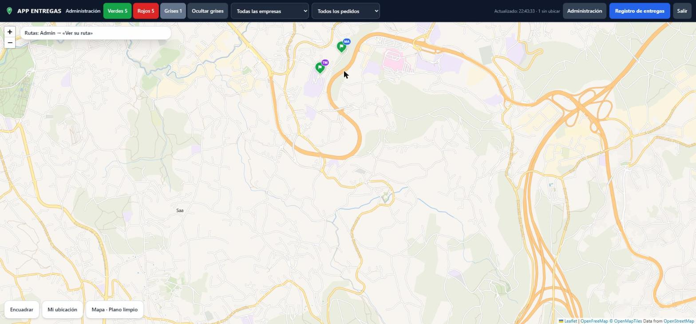

# APP ENTREGAS

**One map for the deliveries of several companies: logistics on the desktop, couriers on their phones, and a record of who delivered what, and when.**

[What it does](#what-it-does) · [Screenshots](#screenshots) · [Who built what](#who-built-what) · [Access](#want-to-try-it)

---

> **This is a showcase repository: it contains the write-up and screenshots only, not the source code.**
> The application is built for real use by the people who made it, so the code stays private. Everything you see
> below was captured on a demo database with **fictional** companies, customers and couriers.

## What it does

A small group of companies shares the same couriers and the same customers. Before this app, "is that order ready, and
who is taking it?" was answered with phone calls. APP ENTREGAS puts it on one map.

- **A flag per customer, coloured by order state.** Grey: nothing pending. Red: being produced. Green: ready to deliver.
  Two-tone: the customer has both. Each flag carries the badge and colour of the issuing company.
- **Couriers work from the phone** (installable web app). They open a customer, jump to **Google Maps or Waze**, and
  press *Mark as delivered*, which is only possible when the order is ready.
- **Traceability.** Every delivery stores courier, order, customer, company and the **server's** clock, and can be
  exported to CSV.
- **Routes.** A courier picks the ready orders they are taking; the stops are ordered by **real driving time**, drawn on
  the road with direction arrows, and checked off automatically when they deliver or come within 60 m (GPS). A skipped
  stop raises one clear warning.
- **Route timing.** A stopwatch, an optional deadline with a countdown, and an estimated arrival time per stop that
  **learns from finished routes** (real time per customer, real vs. map time). Administration gets a history per
  courier and per month, with slow routes highlighted.
- **Administration.** Assign and reassign ready orders to couriers, send a free-text notice, import orders from CSV,
  manage couriers and permissions, and read the access log. Three roles: courier, coordinator, administrator.
- **Works with bad coverage.** A delivery made without signal is queued on the phone with its real time and sent
  when the connection returns, without duplicates.
- **Orders until the ERP is connected.** Orders come in by CSV (or by an API entry point meant for a future sync with
  the companies' ERP and production system, read-only).

## Screenshots

All captures come from the current build, using demo data.

### The map and a courier's route
Flags by state and company, the route on the road with direction arrows and numbered stops.

### Courier route panel
Estimated duration and finish time, deadline selector, stops that can be reordered, checked off or removed,
automatic ordering by driving time.

### Customer sheet
Address, Google Maps and Waze, the orders with their state, the company, and *Mark as delivered*, plus the estimated
arrival time for that stop.

### Delivery recorded
After delivering: the stop is checked, the flag turns grey, the route shows progress and the stopwatch runs. The
customer sheet keeps who delivered the last order and when.

### Administration: assigning routes
Ready orders are assigned to a courier (in-process ones cannot be), with the courier's route state, deadline and a
notice box.

### Administration: orders
Mark orders ready or in process, cancel them, or import a batch from CSV.

### Flags up close
Each flag has the badge of the company that issued the order.

## How it is built

| | |
|---|---|
| **Web app** | Plain browser app (no framework): Leaflet and a vector basemap (MapLibre / OpenFreeMap), installable as a PWA with a service worker; libraries bundled locally. |
| **Server** | Node.js with **no external dependencies** and the built-in SQLite. A small REST API; business rules live in one module shared by the browser, the server and the tests. |
| **Routing** | Road routes and driving times from OSRM; geocoding with caching that respects the provider's limits. |
| **Access** | Real login with hashed credentials, server-side permissions per role, protection against cross-site requests, attempt limits and an access log. |
| **Deployment** | Prepared for a small company server: HTTPS reverse proxy, system service, daily backups. |
| **Quality** | **66 automated tests** (business rules, API and security) plus a 22-case end-to-end run in a real browser before release, with the bugs it found fixed (for example a stray tag that hid the whole map). |

## Who built what

The split below comes from the project's git history and from who wrote each line (`git blame`), not from impressions.
At 27/10/2026: **@ImSothe** (Sothe) 15 commits, **@TenMM2** (TenM) 10 commits.

| | **Sothe** ([@ImSothe](https://github.com/ImSothe)) | **TenM** ([@TenMM2](https://github.com/TenMM2)) |
|---|---|---|
| **Role** | Product and prototype; today also quality and polish | Real server, security and time tracking |
| **Phase** | Prototype (14/10), then QA and release polish (27/10) | Server, security, tests, deployment and timing (18-20/10) |
| **Delivers** | What the app does and how it is used, and how it will connect to the companies' systems | How it works inside and how it is installed safely |

**Sothe** designed the concept and the user flows, built the working prototype (map and flags, customer sheet,
courier routes with driving-time ordering and GPS checkpoints, first admin panel, filters, basemap, PWA), designed the
data model and the integration plan, and handles the talks with the companies and ERP vendors. On 27/10 Sothe ran the
pre-release QA (22 cases in a real browser, with a written report), fixed what it found, added the offline delivery
queue and free-text notices, and restyled the interface. Sothe's work is designed, specified and tested by Sothe and
built with AI assistants (Claude Code).

**TenM** turned the prototype into a real system: the dependency-free Node.js server and API, authentication and
roles, the shared business-rules module and the first 52 tests, import by CSV, the deployment kit and guides, and
the route-time tracking (stopwatch, deadlines, learned estimates, monthly history and slow-route detection).

**Shared:** the interface code started in Sothe's prototype and was reorganised, connected to the API and extended by
TenM; today roughly half of its lines are each person's.

## Want to try it?

The source code is closed. If you work in logistics, delivery or production and want to see it running, or you are
a recruiter who wants a walkthrough, reach out on Instagram **[@SoySothe](https://www.instagram.com/soysothe)** or on
**[LinkedIn](https://www.linkedin.com/in/%C3%A1ngel-baz-monteiro-8196a21a9/)**.

## Legal notice

© 2026 Sothe and TenM. All rights reserved. This repository contains documentation and images only; the application
is not open source and is not licensed for use or redistribution. See [LICENSE](LICENSE). All companies, customers
and couriers shown are fictional.
